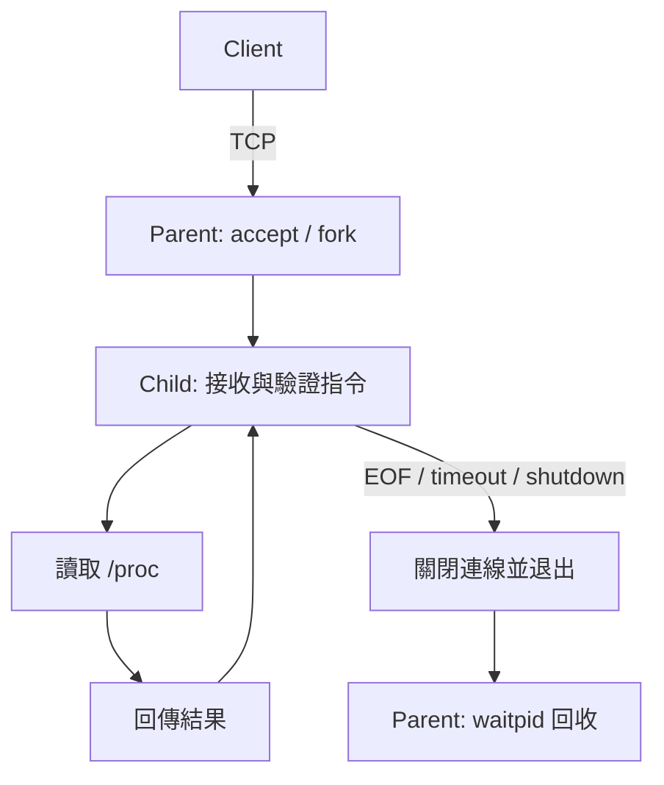

# 系統設計

## 程序架構

Server Parent 使用 nonblocking listener 與 `poll()` 接受 TCP 連線，每條連線以 `fork()` 建立獨立 Child。Parent 關閉 accepted socket；Child 關閉 listener 與 Parent 的 self-pipe，持續處理該連線上的查詢。



Parent 透過 self-pipe 接收 SIGCHLD、SIGINT、SIGTERM 通知。Handler 僅設定旗標並寫入 pipe，日誌與 `waitpid(..., WNOHANG)` 在主迴圈處理。fork 期間暫時阻擋相關訊號，待 Child 安裝 handler、Parent 記錄 PID 後恢復。

關機時停止接受連線，向 Child 傳送 SIGTERM；等待約兩秒後終止剩餘程序並完成回收。I/O 單次 poll 最多等待 200 ms，以確保停止旗標能及時被檢查。活動 Child 上限為 128，listener backlog 為 64；`SO_REUSEADDR` 支援服務重新啟動。

## 通訊協定

協定為區分大小寫的 ASCII 文字，以 LF 分隔。Request 上限 128 bytes、Response 上限 2048 bytes，皆包含換行。支援 `GET_STATUS`、`GET_CPU`、`GET_MEM`、`GET_UPTIME`，不接受額外參數、CRLF、NUL 或控制字元。

```text
GET_CPU\n
OK CPU usage_pct=<percent> sample_ms=<milliseconds>\n
```

接收端逐 byte 組合完整訊息，支援分段與連續傳送；傳送端以迴圈處理 partial write、EINTR 與 EAGAIN。`MSG_DONTWAIT` 搭配 `poll()` 與 monotonic 絕對期限，限制完整訊息的收送時間；部分資料不會重設期限。

| 狀況 | 處理方式 |
|---|---|
| 未知指令或多餘參數 | `ERR INVALID_REQUEST`，保留連線 |
| 非法字元或不完整 EOF | 嘗試回傳 `ERR INVALID_REQUEST` 後關閉 |
| 超長訊息 | 嘗試回傳 `ERR REQUEST_TOO_LONG` 後關閉 |
| 讀取逾時 | 嘗試回傳 `ERR TIMEOUT` 後關閉 |
| 系統資料讀取失敗 | `ERR SYSTEM_INFO`，保留連線 |
| Socket 錯誤／正常 EOF | 記錄錯誤或正常關閉 |

正式傳送路徑使用 `MSG_NOSIGNAL` 並處理 EPIPE／ECONNRESET。已斷線的對端可能無法收到錯誤回應。Client 僅接受數字 IP，避免 DNS 解析超出連線期限。

## 共用函式庫與日誌

`libmonitor.so` 封裝連線、收送、期限控制、參數解析與日誌，由 Client、Server 動態連結。函式庫以 PIC 建置，程式透過 `$ORIGIN/../lib` RUNPATH 載入。

`MONITOR_DEBUG` 控制是否編入 DEBUG 呼叫；runtime 層級由兩端各自的 `--log-level` 決定：

| 層級 | 輸出 |
|---|---|
| 0 | ERROR |
| 1 | ERROR、INFO |
| 2 | ERROR、INFO、DEBUG（需 DEBUG=1 建置） |

日誌寫入 stderr，包含時間、PID、角色及層級。查詢事件另記錄 monotonic 時間，供並行分析。不同 DEBUG／VARIANT 使用獨立建置目錄。

## 系統資訊

| 資料 | 來源與計算 |
|---|---|
| CPU | `/proc/stat` 兩次取樣，間隔約 200 ms |
| Memory | `/proc/meminfo`；used = MemTotal − MemAvailable |
| Uptime | `/proc/uptime` 第一欄 |

CPU total 累加 user、nice、system、idle、iowait、irq、softirq、steal；guest 已包含於 user／nice。idle 包含 iowait：

```text
usage_pct = 100 × (total_delta - idle_delta) / total_delta
```

實作檢查 counter 倒退、零差值及不合理數據；記憶體需符合 `0 ≤ available ≤ total`，kB 採 Linux 的 1024-byte 慣例。系統摘要依序收集資料；WSL 數值代表 Linux 環境。

## 防護比較與測試隔離

正式版本保留輸入驗證、讀寫期限、SIGPIPE 防護及程序回收。測試另建 loopback 限定的 Baseline，採前綴解析、取消讀取期限並停用 MSG_NOSIGNAL，供行為比較。

SIGPIPE 使用已關閉對端的 socketpair 重現；TCP reset 另作整合測試。`server-fault` 透過 linker `--wrap=fopen` 模擬讀取失敗；小 socket buffer 與 1 MiB payload 驗證 partial write 及寫入期限。測試替身不編入正式 Server。
