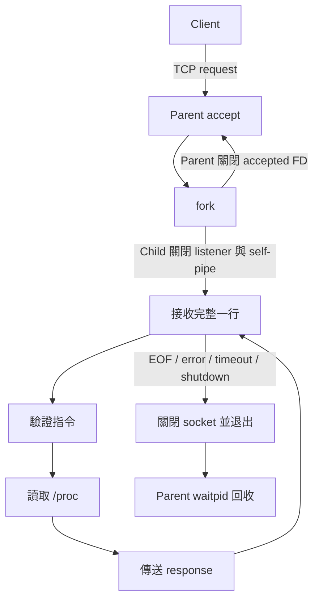

# 系統設計

## 架構與程序模型

Server Parent 綁定數字 IPv4 位址，預設 loopback:8080，使用 TCP socket、`SO_REUSEADDR`、backlog 64 與 nonblocking listener。`poll()` 同時等待 listener 與訊號 self-pipe；`accept()` 後呼叫 `fork()`。沒有使用 thread 處理服務連線。

Parent 關閉 accepted socket、記錄 Child PID，回到接受連線流程；Child 關閉 listener 與兩個 self-pipe FD，只保留自己的連線。單一 Child 依序處理同一條連線上的 request，直到 EOF、錯誤、期限或關機。



SIGCHLD、SIGINT、SIGTERM handler 只更新 `sig_atomic_t` 旗標並向 nonblocking self-pipe 寫入一個 byte，保存 errno；日誌及 waitpid 留在正常控制流程。即使 pipe 已滿，已有可讀資料仍會喚醒 Parent。

fork 前暫時阻擋這三種訊號；Child 關閉 Parent FD、安裝自身 handler 後才恢復 mask，避免啟動期間錯用 Parent handler。Parent 在記錄 PID 後恢復 mask。以 `waitpid(-1, ..., WNOHANG)` 迴圈回收所有已結束 Child。

關機先關閉 listener，再向目前 Child 發 SIGTERM；等待最多約兩秒後才對剩餘 Child 使用 SIGKILL，最後逐一 waitpid。Client／Child 的 handler 設定停止旗標；I/O 每次 poll 最多 200 ms，避免訊號在檢查旗標與等待之間抵達造成長時間漏喚醒。這是阻塞式等待，不是 busy waiting。

PID 表最多 128 個活動 Child，超限直接關閉新連線並記錄錯誤，滿足十人並行且避免無界 fork。accept 遇到不可恢復錯誤時清理退出，避免資源不足時忙迴圈。

## 通訊協定

- ASCII、區分大小寫，以 LF 分隔；不接受 CRLF、控制字元、NUL 或額外空白。
- Request 最多 128 bytes（包含 LF）；buffer 額外保留字串結尾。
- Response 最多 2048 bytes（包含 LF）；一筆 request 對應一筆 response。
- `GET_STATUS`、`GET_CPU`、`GET_MEM`、`GET_UPTIME` 不帶參數。
- 接收逐 byte 組合完整行，因此分段傳送及多筆連續訊息都不會破壞邊界。在此低流量教學專案中，優先選擇簡單可驗證的實作。
- `mon_send_all()` 重複 send，處理 partial write、EINTR、EAGAIN；使用 MSG_DONTWAIT 搭配 poll，避免 readiness 後仍無限阻塞。

| 狀況 | 回應／處理 |
|---|---|
| 完整但未知或格式不符的指令 | `ERR INVALID_REQUEST`，可繼續查詢 |
| 非法字元／不完整 EOF | 嘗試回傳 `ERR INVALID_REQUEST`，關閉 |
| 超長行 | 嘗試回傳 `ERR REQUEST_TOO_LONG`，關閉 |
| 未在期限內完成一行 | 嘗試回傳 `ERR TIMEOUT`，關閉 |
| /proc 讀取或數據驗證失敗 | `ERR SYSTEM_INFO`，可繼續其他查詢 |
| socket 錯誤 | 記錄具體 errno，關閉 |
| 正常 EOF | 關閉，不額外回傳 |

已斷線或 reset 的對端不保證能收到錯誤回應。超長輸入也不會無限排空，以免攻擊者透過持續送資料佔用 Child。

每筆完整行、每次完整傳送都有獨立 monotonic 絕對期限；收到部分資料不重設期限。同一連線的下一筆 request 會重新開始計時。Client 連線亦有期限；僅支援數字 IP，避免 DNS 同步解析突破期限。

## Shared Library

`shared/protocol.c` 提供連線、讀取完整行、完整傳送、poll 期限與整數參數解析；`shared/logging.c` 提供日誌。兩端均直接呼叫 `.so` 中的函式，不是建立後未使用。

Make 以 PIC object 建立 `libmonitor.so`，兩端記錄 DT_NEEDED 與 `$ORIGIN/../lib` RUNPATH。不用 `ldconfig`、全域 LD_LIBRARY_PATH 或寫入 `/usr/lib`。

## 系統資料

CPU 每次查詢讀取兩次 `/proc/stat`，相隔約 200 ms。總量累加 user、nice、system、idle、iowait、irq、softirq、steal；guest 已包含於 user／nice，不重複計算。

```text
total_delta = total_second - total_first
idle_delta  = (idle + iowait)_second - (idle + iowait)_first
usage_pct   = 100 × (total_delta - idle_delta) / total_delta
```

檢查 counter 倒退、零差值及 idle_delta 大於 total_delta 等情況。回傳實際 sample_ms，不把累積 jiffies 當使用率。這是全 CPU 加權平均，短取樣可能有小幅量化誤差。

Memory 使用 `/proc/meminfo` 的 MemTotal、MemAvailable，驗證欄位存在且 `0 ≤ available ≤ total`，used 為兩者相減。kB 沿用 Linux /proc 的單位慣例（1024 bytes）。Uptime 使用 `/proc/uptime` 第一欄。

GET_STATUS 依序收集三類資訊，不宣稱是同一時間點的原子快照。WSL 數值只代表 Linux 執行環境。

## 日誌

`MONITOR_DEBUG` 在前處理階段決定是否保留 LOG_DEBUG 呼叫；runtime level 決定是否輸出已編入的訊息。ERROR 永遠保留，INFO 在 runtime ≥ 1，DEBUG 要同時具備 compile DEBUG=1 與 runtime=2。

日誌寫入 stderr，每行包含 wall-clock 時間、PID、角色及層級；request_start／end 另含 monotonic 時間供比較處理區間。單次 write 減少多程序日誌交錯，不承諾任意輸出媒介的絕對原子性。

不同 DEBUG／VARIANT 有不同 build 路徑，避免編譯旗標切換時誤用舊 object。命令列 `make DEBUG=0` 可覆寫預設值；刻意不繼承環境中可能與本專案無關的 DEBUG 字串。

## Robustness 與對照

正式版本具備長度／格式驗證、完整 request 期限、傳送期限、MSG_NOSIGNAL、錯誤回傳及程序回收。Baseline 只透過 `MONITOR_TEST_BASELINE` 專用建置啟用，限制 loopback，不會取代預設版本。

- A：Baseline 安全地截取有界前綴並寬鬆解析，因此會誤接受 `GET_MEM garbage` 或長行；正式版拒絕。沒有越界寫入或未定義行為。
- B：Baseline 不設定讀取期限；測試在固定觀察期間確認 Child 仍等待，然後主動關閉連線清理。正式版則在 400 ms 測試期限後回收。
- C：兩版本皆保留 SIGPIPE 預設行為，Baseline send 不設 MSG_NOSIGNAL；以已關閉 socketpair 對端比較 signal 退出與 EPIPE 回傳。這直接呼叫兩版的 shared-library 傳送函式。TCP reset 另作真實整合驗證，不預設第一次 send 一定收到 SIGPIPE。

額外測試透過 linker `--wrap=fopen` 建立獨立 `server-fault`，只在測試中模擬 /proc 讀取失敗；正式 Server 不包含此替身，也不修改真實 /proc。小傳送 buffer 與 1 MiB payload 的 socketpair 測試驗證 partial write 及寫入期限；該測試不改變正式文字協定的訊息上限。

## 範圍與限制

只使用 TCP、fork、/proc 與共用函式庫；沒有 thread-based Server、Web、資料庫、TLS 或額外 IPC 服務。Python threads 只用於測試端同步十個 Client。

Server 只接受 IPv4 bind；Client 接受數字 IP。教學展示預設同機 loopback；沒有擴大為跨主機或高負載服務。測試會檢查已觀察到的 FD 穩定性與 Child 清理，不將有限測試宣稱為不存在任何資源洩漏的形式證明。
