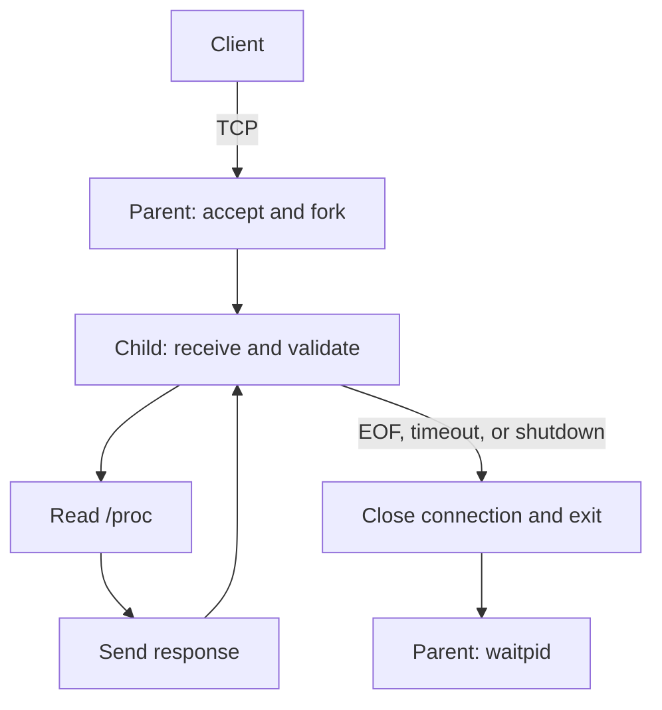

# Linux System Monitor — Project Report

## Overview

Linux System Monitor provides remote access to Linux CPU, memory, and uptime measurements through a line-based TCP protocol. A parent server accepts connections and forks a child for each client. Both programs dynamically link to a common library for protocol I/O and logging.

## Architecture and process management



The parent closes each accepted socket after fork. Each child closes the listening socket and both parent self-pipe descriptors, then handles multiple requests on its own connection. A nonblocking listener and `poll()` allow the parent to accept connections and process signal notifications.

Signal handlers update flags and write to the self-pipe; logging and `waitpid(..., WNOHANG)` run in the main loop. SIGCHLD, SIGINT, and SIGTERM are blocked across fork until PID registration and child handler setup are complete. Shutdown closes the listener, sends SIGTERM to children, waits approximately two seconds, and terminates and reaps any remaining children. I/O polls check cancellation at intervals of at most 200 ms.

The listener backlog is 64, with a limit of 128 active children. `SO_REUSEADDR` supports restarting on the same port.

## Protocol and system measurements

Requests and responses are case-sensitive ASCII lines terminated by LF. Requests are limited to 128 bytes and responses to 2048 bytes, including LF. Commands take no arguments.

| Command | Measurement |
|---|---|
| `GET_STATUS` | CPU, memory, and uptime overview |
| `GET_CPU` | Two `/proc/stat` samples, approximately 200 ms apart |
| `GET_MEM` | MemTotal and MemAvailable from `/proc/meminfo` |
| `GET_UPTIME` | First value in `/proc/uptime` |

```text
GET_CPU\n
OK CPU usage_pct=<percent> sample_ms=<milliseconds>\n
```

CPU total includes user, nice, system, idle, iowait, irq, softirq, and steal. Guest time is already included in user/nice. Idle includes iowait:

```text
CPU utilization = 100 × (total_delta - idle_delta) / total_delta
Used memory     = MemTotal - MemAvailable
Memory usage    = 100 × used / total
```

Counter regressions, zero deltas, missing fields, and inconsistent values produce an error. Linux memory kB denotes 1024 bytes. Status fields are collected sequentially; WSL measurements represent its Linux environment.

The receiver assembles complete lines across partial reads, including consecutive requests. The sender loops over partial writes, EINTR, and EAGAIN. Nonblocking operations and monotonic deadlines limit each complete read or write; partial input does not extend the deadline. Clients accept numeric IP addresses to avoid an unbounded DNS lookup.

| Condition | Handling |
|---|---|
| Unknown command or extra arguments | INVALID_REQUEST; connection remains usable |
| Invalid characters or incomplete EOF | Attempt INVALID_REQUEST, then close |
| Oversized input | Attempt REQUEST_TOO_LONG, then close |
| Request timeout | Attempt TIMEOUT, then close |
| System information failure | SYSTEM_INFO; other queries remain available |
| Socket error or normal EOF | Log as appropriate and close |

Errors use the `ERR <code>` format. A disconnected peer may not receive the error response. `MSG_NOSIGNAL` prevents SIGPIPE termination; send failures such as EPIPE and ECONNRESET are handled explicitly.

## Shared library and logging

`libmonitor.so` contains connection, framing, complete-send, deadline, parameter-validation, and logging functions used by both executables. PIC objects form the shared library; `$ORIGIN/../lib` RUNPATH resolves it without global library configuration.

`make DEBUG=0` removes DEBUG calls at compile time. `--log-level` independently controls each program: 0 emits ERROR, 1 adds INFO, and 2 adds compiled DEBUG messages. Logs go to stderr and include time, PID, role, and severity. Request events also record monotonic timestamps. Separate build directories isolate compile configurations and the test-only Baseline variant.

## Verification results

The full verification on 2026-11-13 used WSL2 Ubuntu 26.04.1 LTS, GCC 15.2.0, Make 4.4.1, GDB 17.1, and tcpdump 4.99.6. Clean builds completed without warnings. [Full transcript](evidence/verification/transcript.txt), [result](evidence/verification/result.json), and [source hashes](evidence/verification/source-sha256.json) are retained.

| Area | Observed result | Evidence |
|---|---|---|
| Queries and interface | Four commands, menu, monitoring, Ctrl+C, partial input, and framing boundaries passed | [Functional test](evidence/verification/tests/basic/transcript.txt) |
| System data | CPU sampling, memory arithmetic and /proc comparison, and uptime tolerance passed | Same functional test |
| Concurrency | Ten children; 200 ms overlap across all processing intervals | [Timings](evidence/verification/tests/concurrency/timings.json) |
| Dynamic linking | Both programs loaded local libmonitor.so with the expected RUNPATH | Full transcript above |
| Logging | Both compile configurations and all client/server runtime level combinations passed | [Logging test](evidence/verification/tests/logging/transcript.txt) |
| Lifecycle | Parent FD count remained 6 after 30 connections; children were reaped; same-port restart succeeded | [Lifecycle test](evidence/verification/tests/lifecycle/transcript.txt) |
| Read failures | Injected /proc open failures returned SYSTEM_INFO while unaffected queries worked | [Fault test](evidence/verification/tests/proc-errors/transcript.txt) |
| Write behavior | 1 MiB transferred and verified; a blocked writer timed out after 100 ms | [I/O test](evidence/verification/tests/io/transcript.txt) |

Ten connections were held open and synchronized with a barrier before sending GET_CPU. Child PIDs 25965–25974 belonged to the same parent. Concurrent completion took 0.232571 s, compared with 2.014228 s sequentially; server timestamps established a 200 ms common overlap. These are observations from that run, not performance guarantees.

The terminal demonstration workflow was also exercised on 2026-11-13. [Demonstration logs](evidence/demo/) record clean build, queries, concurrency, linkage, logging, robustness, saved-pcap analysis, and lifecycle steps. That concurrency run took 0.232919 s concurrently and 2.014874 s sequentially, with 200 ms common server overlap.

[Interactive checks](evidence/demo/script-checks.log) verified menu selection, screenshot pauses, invalid arguments, missing capture files, signal cleanup, port-conflict handling, and rejection of an unsafe evidence root. A separately running server remained available after the demo encountered its occupied port. These checks did not perform a new privileged capture.

## Robustness comparisons

A separate loopback-only Baseline uses bounded prefix parsing, omits request deadlines, and disables MSG_NOSIGNAL. The default Protected build retains all safeguards.

| Scenario | Baseline | Protected |
|---|---|---|
| Extra arguments / 208-byte line | Incorrectly accepted GET_MEM prefixes | INVALID_REQUEST / REQUEST_TOO_LONG |
| Silent client | Child still waiting after approximately 0.8 s | 400 ms deadline, TIMEOUT, and cleanup |
| Closed-peer send | SIGPIPE termination, subprocess exit -13 | EPIPE returned; probe exited normally |
| TCP reset | ECONNRESET recorded; parent remained available | ECONNRESET recorded; parent remained available |

[Comparison transcript](evidence/verification/tests/robustness/transcript.txt). Slow partial input also failed to extend the deadline. SIGPIPE was reproduced using socketpair against the same shared-library send function; TCP reset was a separate integration test. The baseline uses bounded buffers and no intentional memory corruption. Fault injection uses a separate `server-fault` binary with linker wrapping of fopen, leaving the normal server and `/proc` unchanged.

## Packet capture and analysis

A manual tcpdump capture on `lo`, filtered by TCP port 8080, recorded four queries on 2026-11-08 at 20:26:56–20:26:57 Asia/Taipei. The [pcap](evidence/packet-capture/monitor.pcap) contains 46 complete Ethernet records (4,183 bytes), five SYN/SYN-ACK pairs, ten FIN flags, and no RST. One connection is a readiness probe; the other four each carry one request and response.

The operator supplied the final [tcpdump statistics](evidence/packet-capture/tcpdump-stats.txt):

```text
46 packets captured
92 packets received by filter
0 packets dropped by kernel
```

Filter counts are kernel capture statistics, distinct from saved packet records. [Application output](evidence/packet-capture/traffic.txt), [decoded packets](evidence/packet-capture/packets.txt), [hex output](evidence/packet-capture/packets-hex.txt), and [structured analysis with SHA-256](evidence/packet-capture/analysis.json) are preserved.

| Command | Client port | Request / response packet | Payload bytes | Request-to-response |
|---|---|---|---|---|
| GET_STATUS | 40932 | 10 / 12 | 11 / 130 | 200.821 ms |
| GET_CPU | 40942 | 20 / 22 | 8 / 36 | 200.715 ms |
| GET_MEM | 40954 | 30 / 32 | 8 / 76 | 0.672 ms |
| GET_UPTIME | 40962 | 40 / 42 | 11 / 27 | 0.396 ms |

The GET_MEM flow, packets 27–36, shows SYN, SYN-ACK, ACK; an 8-byte request at 12:26:57.369096 UTC (relative seq 1:9); ACK 9; a 76-byte response at 12:26:57.369768 UTC (seq 1:77); ACK 77; and a normal FIN exchange. ACK and FIN are combined, so closure uses three segments. SYN and FIN each consume one sequence number.

Request hex is `47 45 54 5f 4d 45 4d 0a`; LF (`0a`) also terminates the response. Each message happened to fit one segment in this capture; TCP does not preserve application message boundaries. tcpdump may label port 8080 traffic as HTTP, but the payload uses the application's own line protocol.

## Reproduction and limitations

Use the [demonstration guide](demo_guide.md) to obtain terminal-window screenshots and English figure captions. Evidence is grouped into `verification/`, `demo/`, and `packet-capture/` under `docs/evidence/`. Filenames describe purpose; UTC times remain inside logs and result JSON. Re-running a test or demo replaces its previous output, so report figures should be refreshed after a new run. Packet replay is clearly dated and separated from a new live capture.

The recorded successful capture used manual tcpdump. The existing automatic capture script has syntax and permission-failure checks; its privileged success path is not covered by that record. The guided live demo requires a user-operated tcpdump terminal and is not an automated privileged capture.

The service uses IPv4 server binding, numeric client addresses, and a fixed child limit. Measurements, deadlines, and resource checks describe the tested Linux environment; finite tests do not prove the absence of every possible resource leak.
